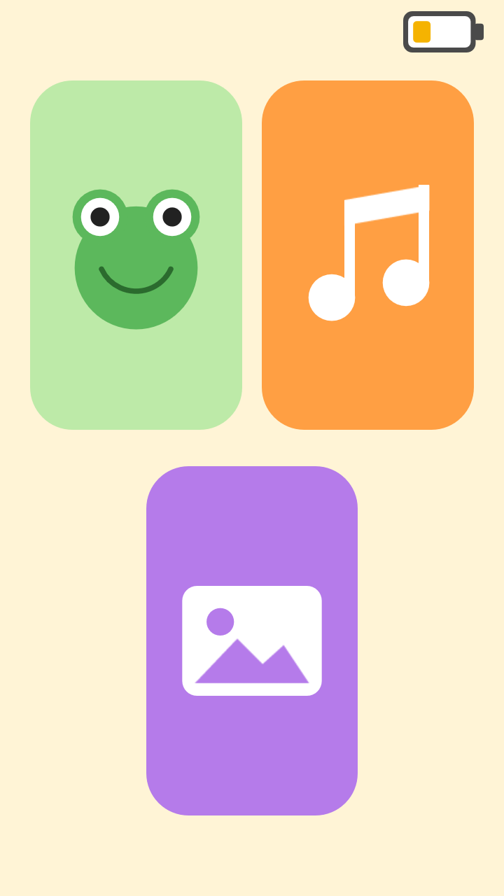

# Tierfon

Ein Kindertelefon zum Spielen auf einem alten Moto G (3. Generation). Das Kind kann Tiere „anrufen“, Musik hören und Fotos ansehen, höchstens 30 Minuten am Tag. Internet gibt es auf dem Gerät nicht.

**Stand:** Die App läuft auf dem Moto G: Startbildschirm, Tierauswahl, Anruf beim Frosch, Musikplayer (noch ohne Lieder getestet) und das Zeitlimit mit Batteriesymbol. Die Sperre ist programmiert, aber auf dem Gerät noch nicht aktiviert.

| Startbildschirm | Anruf beim Frosch | Musik |
|---|---|---|
|  |  |  |

## Zielgerät

| | |
|---|---|
| Gerät | Motorola Moto G 3. Gen. (`osprey`, XT1541), 1 GB RAM, 8 GB Speicher |
| System | LineageOS 14.1 (Android 7.1.2, API-Level 25) |
| Bildschirm | 5 Zoll, 720 × 1280, Hochformat |

## Was das Kind benutzen kann

Der Startbildschirm zeigt drei Kacheln. Alles andere auf dem Telefon ist entfernt, ausgeblendet oder gesperrt.

- **Tiere anrufen:** Es klingelt, das Tier nimmt ab und erscheint bildschirmfüllend wie bei einem Videoanruf. Bisher gibt es den Frosch; Igel, Waschbär und Brontosaurus folgen.
- **Reagieren auf Sprache:** Das Mikrofon misst nur die Lautstärke. Spricht das Kind, hört das Tier zu. Wird es still, blabbert das Tier in seiner eigenen Stimme zurück. Es wird nichts aufgenommen oder gespeichert.
- **Berührung:** Antippen lässt das Tier hüpfen und kurz quaken.
- **Musik:** Spielt MP3-Dateien aus dem Ordner `Music` des Telefons, mit drei großen Tasten. Die Musik läuft bei ausgeschaltetem Bildschirm weiter.
- **Galerie:** Die vorhandene Android-App, über eine eigene Kachel erreichbar.
- **Kamera:** Für das Kind gesperrt. Die Eltern können sie im Elternbereich freigeben, dann erscheint eine vierte Kachel.

## Spielzeit: 30 Minuten am Tag

- Gezählt wird jede Sekunde, in der der Bildschirm an ist, auch in der Galerie.
- Ein Batteriesymbol oben rechts zeigt, wie viel Zeit heute noch übrig ist (grün, gelb, rot).
- Ist die Zeit aufgebraucht, stoppt die Musik, der Bildschirm wird schwarz und reagiert nicht mehr. Nach wenigen Sekunden schaltet er sich aus.
- Am nächsten Kalendertag stehen wieder 30 Minuten zur Verfügung.
- Musik bei ausgeschaltetem Bildschirm verbraucht keine Spielzeit, endet aber, sobald die Zeit aufgebraucht ist.
- Die Eltern können die Zeit im Elternbereich zurücksetzen.

## Die Sperre

Tierfon wird per `adb` als „Gerätebesitzer“ eingetragen. Damit kann die App:

- der einzige Startbildschirm sein,
- das Telefon in den Sperrmodus von Android versetzen: Statusleiste, Home-Taste und App-Übersicht sind abgeschaltet, erlaubt sind nur Tierfon und die Galerie,
- alle anderen Apps mit Start-Symbol ausblenden (rückgängig machbar),
- gespeicherte WLANs löschen, das WLAN ausschalten und WLAN-Einstellungen sperren,
- das Installieren von Apps und den abgesicherten Modus sperren,
- den Bildschirm ausschalten, wenn die Spielzeit vorbei ist.

Die App selbst hat keine Internet-Berechtigung.

### Rückwege

1. **Am Telefon:** Auf dem Startbildschirm (oder auf dem schwarzen Bildschirm) die rechte obere Ecke drei Sekunden gedrückt halten und die PIN eingeben. Der Elternbereich setzt Sperre und Zeitlimit für 15 Minuten aus und führt zu den Bluetooth- und Android-Einstellungen. Dort lässt sich die Sperre auch vollständig aufheben.
2. **Am PC:** `scripts/freigeben.sh` hebt die Sperre über USB auf und blendet alle Apps wieder ein. Dafür bleibt das USB-Debugging eingeschaltet.

Die PIN ist nach der Installation `2580` und sollte im Elternbereich sofort geändert werden.

## Bauen und einrichten

Voraussetzungen: JDK 17, Android SDK (Build-Tools 35, Plattform 35) und Git Bash. Gradle wird nicht gebraucht.

```bash
bash build.sh
```

```bash
bash scripts/einrichten.sh
```

`einrichten.sh` installiert die App, entfernt alle vom Nutzer installierten Apps und aktiviert die Sperre. Vorher müssen alle Konten vom Telefon entfernt sein (Einstellungen → Konten), sonst verweigert Android den Gerätebesitz.

Musik kommt per USB aufs Telefon:

```bash
adb push lied.mp3 /sdcard/Music/
```

Die heute verbrauchte Spielzeit lässt sich vom PC aus setzen, hier auf 0 Minuten:

```bash
adb shell am broadcast -a de.kungfubrot.tierfon.SET_USED -n de.kungfubrot.tierfon/.ReleaseReceiver --ei minutes 0
```

Bluetooth-Boxen oder Kopfhörer koppeln die Eltern einmal über den Elternbereich. Danach verbinden sie sich automatisch.

## Technik

- Native Android-App in Java, ohne Bibliotheken. Die APK ist rund 40 KB groß.
- Alle Bilder werden im Code gezeichnet und alle Töne im Code erzeugt. Das Projekt enthält keine fremden Bild- oder Tondateien.
- Der erste Versuch mit Godot 4 lief am PC, stürzte auf dem Moto G aber im alten Grafiktreiber (Adreno 306) ab. Er liegt noch in der Git-Historie.

## Etappen

1. Grundgerüst mit dem Frosch (fertig, läuft auf dem Gerät)
2. Zeitlimit mit Batteriesymbol (fertig, auf dem Gerät getestet)
3. Sperre auf dem Gerät aktivieren und prüfen (offen)
4. Musikplayer mit echten Liedern und Bluetooth testen (offen)
5. Die übrigen drei Tiere (offen)

## Offene Punkte

- Wie gut die Erkennung „Kind spricht“ mit dem Mikrofon des Moto G eingestellt ist, muss ein Mensch ausprobieren.
- Die Galerie ist eine fremde App. Ob sich aus ihr heraus etwas Unerwünschtes öffnen lässt (zum Beispiel „Teilen“), ist erst mit aktiver Sperre zu prüfen.
- Die Uhr des Telefons bestimmt, wann ein neuer Tag beginnt. Ohne Internet stellt sie sich nicht selbst nach.
- Das eigene Kamerabild in der Ecke („wie FaceTime“) ist ein mögliches Extra.

## Was nicht ins Repository gehört

- Die eigene Eltern-PIN, Seriennummern und IMEI des Geräts
- Eigene MP3-Dateien (Urheberrecht)
- Fotos oder Tonaufnahmen von Kindern
