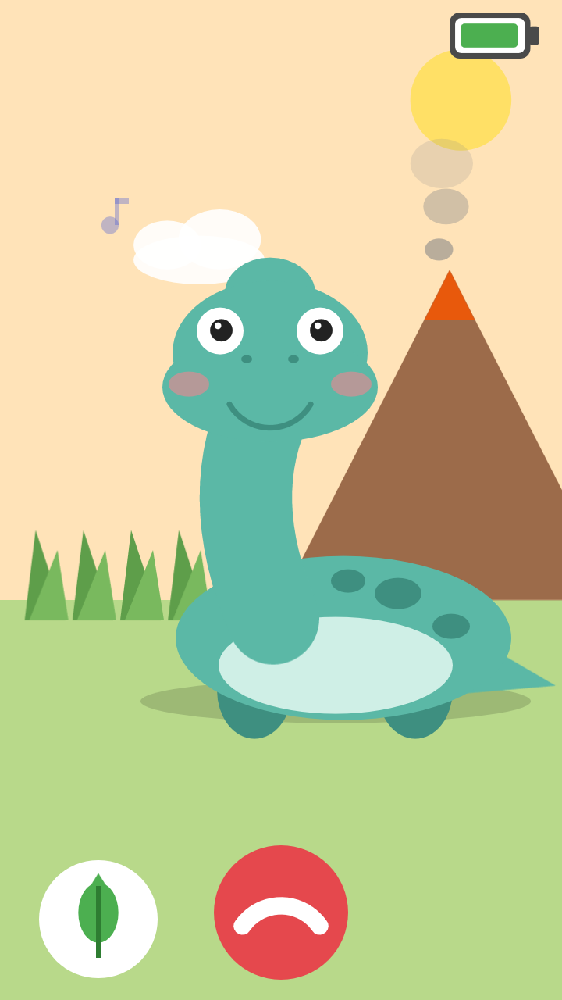
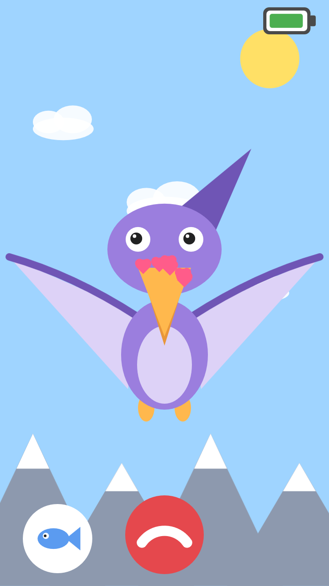

# Tierfon

Ein Kindertelefon zum Spielen auf einem alten Moto G (3. Generation). Das Kind kann Tiere „anrufen“ und Musik hören, höchstens 30 Minuten am Tag. Internet gibt es auf dem Gerät nicht.

**Stand:** Die App läuft auf dem Moto G, und die Sperre ist dort aktiv. Getestet sind die vier Tiere, das Füttern, das Zeitlimit, die Lautstärkegrenze, die Sperre und beide Rückwege. Noch nicht getestet sind der Musikplayer mit echten Liedern und Bluetooth.

Für Eltern gibt es eine eigene [Anleitung](ANLEITUNG.md).

| Tierauswahl | Brachiosaurus | Pterodactylus beim Füttern |
|---|---|---|
|  |  |  |

## Zielgerät

| | |
|---|---|
| Gerät | Motorola Moto G 3. Gen. (`osprey`, XT1541), 1 GB RAM, 8 GB Speicher |
| System | LineageOS 14.1 (Android 7.1.2, API-Level 25) |
| Bildschirm | 5 Zoll, 720 × 1280, Hochformat |

## Was das Kind benutzen kann

Der Startbildschirm zeigt zwei Kacheln: Tiere und Musik. Alles andere auf dem Telefon ist entfernt, ausgeblendet oder gesperrt.

### Tiere anrufen

Es gibt Frosch, Igel, Brachiosaurus und Pterodactylus. Es klingelt, dann erscheint das Tier in seiner eigenen Kulisse (Teich, Wald, Vulkan, Himmel).

- **Sprechen:** Das Mikrofon misst nur die Lautstärke. Spricht das Kind, hört das Tier zu. Wird es still, antwortet das Tier in seiner eigenen Stimme, und Noten steigen auf. Es wird nichts aufgenommen oder gespeichert.
- **Antippen:** Das Tier hüpft, und Herzen steigen auf.
- **Füttern:** Der runde Knopf unten links wirft einen Leckerbissen (Fliege, Apfel, Blatt, Fisch). Das Tier schmatzt und bedankt sich.
- **Laut rufen:** Das Tier erschrickt und springt hoch.
- **Von selbst:** Alle paar Sekunden meldet sich das Tier, auch wenn nichts passiert.

### Musik

Spielt MP3-Dateien aus dem Ordner `Music` des Telefons, mit drei großen Tasten. Die Musik läuft bei ausgeschaltetem Bildschirm weiter.

### Galerie und Kamera

Beide sind für das Kind gesperrt. Die Eltern können sie im Elternbereich einzeln freigeben, dann erscheint jeweils eine weitere Kachel.

## Grenzen

- **Spielzeit:** 30 Minuten pro Kalendertag. Gezählt wird jede Sekunde, in der der Bildschirm an ist. Ein Batteriesymbol oben rechts zeigt die Restzeit. Ist sie aufgebraucht, stoppt die Musik, der Bildschirm wird schwarz und schaltet sich nach wenigen Sekunden aus.
- **Lautstärke:** höchstens 60 Prozent. Die Lauter-Taste wirkt nur bis dorthin, und ein Wächter dreht die Lautstärke jede Sekunde zurück, falls sie höher steht. Die Eltern können die Grenze auf 40, 60, 80 oder 100 Prozent stellen.
- **Kein Internet:** Die App hat keine Internet-Berechtigung. Gespeicherte WLANs werden gelöscht, das WLAN wird ausgeschaltet und seine Einstellungen werden gesperrt.

## Die Sperre

Tierfon wird per `adb` als „Gerätebesitzer“ eingetragen. Damit kann die App:

- der einzige Startbildschirm sein,
- das Telefon in den Sperrmodus von Android versetzen: Statusleiste, Home-Taste und App-Übersicht sind abgeschaltet, erlaubt ist nur Tierfon,
- alle anderen Apps mit Start-Symbol und die Google-Dienste ausblenden (rückgängig machbar),
- den abgesicherten Modus sperren,
- den Bildschirm ausschalten, wenn die Spielzeit vorbei ist.

### Rückwege

1. **Am Telefon:** Auf dem Startbildschirm oder dem schwarzen Bildschirm die rechte obere Ecke drei Sekunden gedrückt halten und die PIN eingeben. Der Elternbereich setzt Sperre und Zeitlimit für 15 Minuten aus. Dort lässt sich die Sperre auch vollständig aufheben.
2. **Am PC:** `bash scripts/freigeben.sh` hebt die Sperre über USB auf und blendet alle Apps wieder ein. Dafür bleibt das USB-Debugging eingeschaltet.

## Bauen und einrichten

Voraussetzungen: JDK 17, Android SDK (Build-Tools 35, Plattform 35) und Git Bash. Gradle wird nicht gebraucht.

```bash
bash build.sh
```

```bash
bash scripts/einrichten.sh 1234
```

`einrichten.sh` installiert die App, setzt die Eltern-PIN (hier `1234`, ohne Angabe gilt `2580`), entfernt alle vom Nutzer installierten Apps und aktiviert die Sperre. Vorher müssen alle Konten vom Telefon entfernt sein (Einstellungen → Konten), sonst verweigert Android den Gerätebesitz.

Eine neue Version lässt sich bei aktiver Sperre direkt aufspielen:

```bash
adb install -t -r build/tierfon.apk
```

Musik kommt per USB aufs Telefon:

```bash
adb push lied.mp3 /sdcard/Music/
```

Weitere Befehle vom PC, jeweils an `de.kungfubrot.tierfon/.ReleaseReceiver`:

| Aktion | Wirkung |
|---|---|
| `de.kungfubrot.tierfon.SET_USED --ei minutes 0` | Setzt die heute verbrauchte Spielzeit |
| `de.kungfubrot.tierfon.SET_PIN --es pin 1234` | Setzt die Eltern-PIN |
| `de.kungfubrot.tierfon.LOCK` | Beendet den Elternmodus sofort |
| `de.kungfubrot.tierfon.RELEASE` | Hebt die Sperre vollständig auf |

Beispiel:

```bash
adb shell am broadcast -a de.kungfubrot.tierfon.SET_USED -n de.kungfubrot.tierfon/.ReleaseReceiver --ei minutes 0
```

## Technik

- Native Android-App in Java, ohne Bibliotheken. Die APK ist rund 45 KB groß.
- Alle Bilder werden im Code gezeichnet und alle Töne im Code erzeugt. Das Projekt enthält keine fremden Bild- oder Tondateien.
- Ein neues Tier ist eine Klasse, die von `Animal` ableitet und Aussehen, Kulisse und Stimme liefert.
- Der erste Versuch mit Godot 4 lief am PC, stürzte auf dem Moto G aber im alten Grafiktreiber (Adreno 306) ab. Er liegt noch in der Git-Historie.

## Offene Punkte

- Der Musikplayer ist noch nicht mit echten Liedern getestet, Bluetooth auch nicht.
- Wie die Tierstimmen klingen und wie gut die Erkennung „Kind spricht“ eingestellt ist, muss ein Mensch ausprobieren.
- Der Google-Dienst `com.google.android.gms` ließ sich nicht ausblenden. Ohne Konto und Internet hat er keine Funktion.
- Die Uhr des Telefons bestimmt, wann ein neuer Tag beginnt. Ohne Internet stellt sie sich nicht selbst nach.
- Wird die Galerie freigegeben, ist noch zu prüfen, ob sich aus ihr heraus etwas Unerwünschtes öffnen lässt (zum Beispiel „Teilen“).

## Was nicht ins Repository gehört

- Die eigene Eltern-PIN, Seriennummern und IMEI des Geräts
- Eigene MP3-Dateien (Urheberrecht)
- Fotos oder Tonaufnahmen von Kindern
